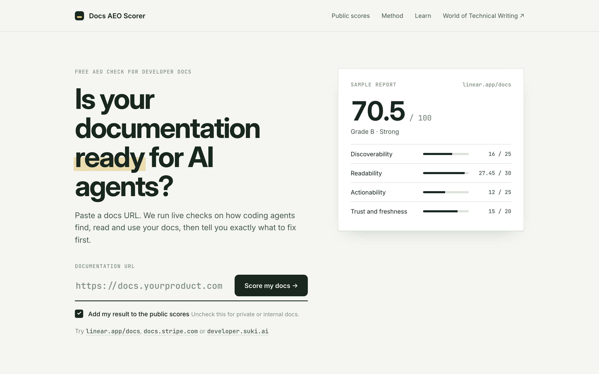
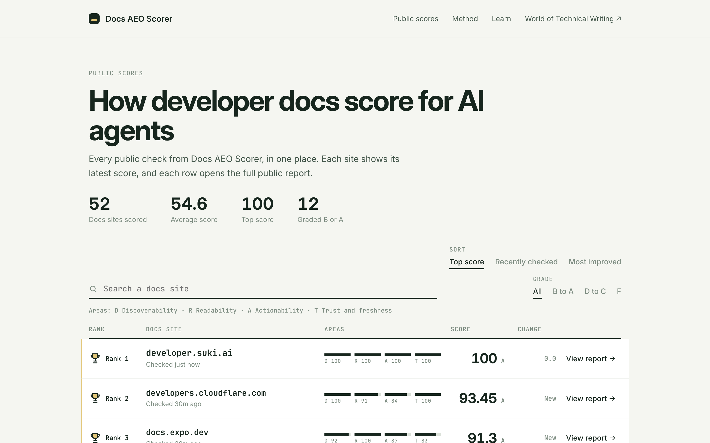
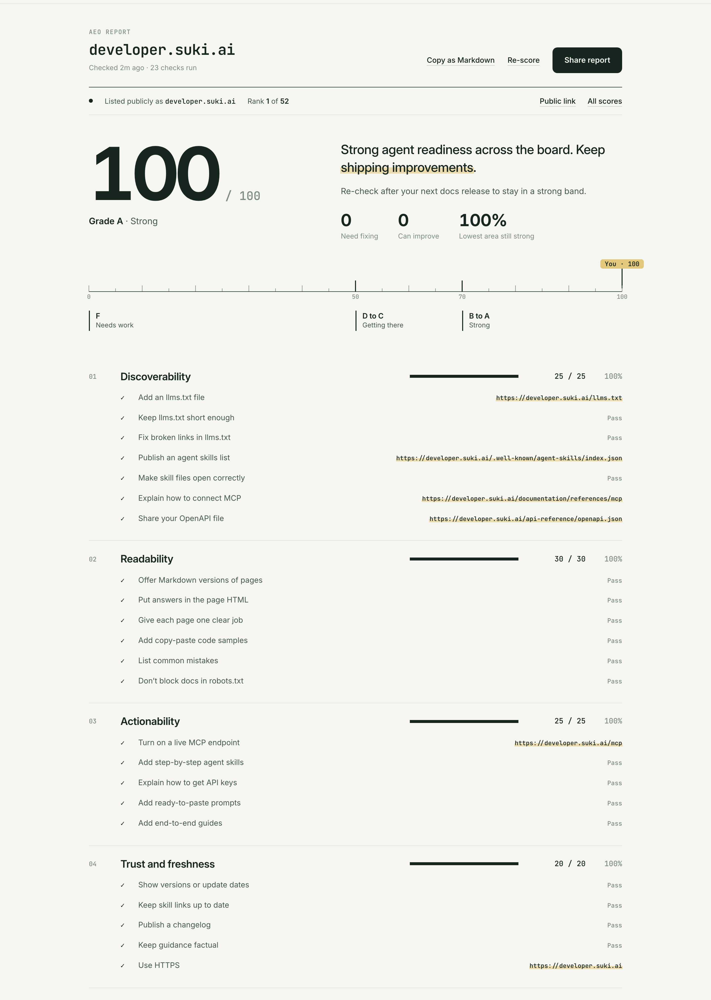

# Docs AEO Scorer

**Live AEO checks for developer documentation — find out if coding agents can find, read, and use your docs.**

[](https://github.com/meharshit/docs-aeo-scorer/blob/main/LICENSE)
[](https://github.com/meharshit/docs-aeo-scorer)

**Repo:** [meharshit/docs-aeo-scorer](https://github.com/meharshit/docs-aeo-scorer) · **Related:** [Docsense](https://github.com/meharshit/docsense) · **Writing:** [World of Technical Writing](https://tech-writing.hashnode.dev/)

Paste a docs URL. Docs AEO Scorer runs live checks against your site for the signals coding agents rely on — `llms.txt`, agent skills, MCP, markdown mirrors, and more — then returns a score, grade, and ranked list of what to fix first. This is **Answer Engine Optimization (AEO)**, not Google SEO.

<p align="center">
  
</p>

## Quickstart

### 1. Install

```bash
git clone https://github.com/meharshit/docs-aeo-scorer.git
cd docs-aeo-scorer
npm install
npm run build
```

### 2. Score from the CLI

```bash
npm run score -- https://developer.suki.ai
```

### 3. Run the web UI

```bash
npm run dev:web
```

Open [http://127.0.0.1:5173](http://127.0.0.1:5173), paste a docs URL, and score. Leave **Add my result to the public scores** checked to list the site on `/scores`.

## Why Docs AEO Scorer?

Agents do not browse like people. They look for machine-readable entry points, structured skills, live tools, and trustworthy freshness signals. Most docs sites were built for human readers first, so those signals are easy to miss.

Docs AEO Scorer turns that gap into a concrete checklist:

- **Score what agents actually need:** Live probes for `llms.txt`, skills indexes, MCP, markdown mirrors, and related signals — not keyword SEO.
- **Get a ranked fix list:** Each report highlights what to ship first, with paths and impact.
- **Compare in public:** Optional public scores board so teams can see how their docs sit next to others.
- **Keep the rubric versioned:** Weights and checks live in `@aeo-docs-scorer/rubric` so scores stay comparable as the product evolves.
- **Run locally or deploy:** Monorepo with a Node scanner, SQLite-backed public scores, and a Vite UI ready for Vercel.

## What we check

| Area | Points | What it covers |
| --- | --- | --- |
| **Discoverability** | 25 | `llms.txt`, agent skills index, MCP advertised, OpenAPI |
| **Readability** | 30 | Markdown mirrors, usable HTML/text body, samples, robots |
| **Actionability** | 25 | Live MCP, task skills, auth for agents, prompts, cookbooks |
| **Trust and freshness** | 20 | Freshness, consistency, HTTPS |

Full check list: [`packages/rubric/src/rubric.v0.1.json`](packages/rubric/src/rubric.v0.1.json).

Grades: **A** ≥ 85 · **B** ≥ 70 · **C** ≥ 60 · **D** ≥ 50 · else **F**.

## Architecture and packages

```
docs-aeo-scorer/
  packages/rubric/         # Versioned scoring contract
  packages/scanner/        # Live fetch probes + score engine + CLI
  packages/public-scores/  # SQLite / Turso store for the public board
  apps/web/                # Vite UI + local API plugin
  api/                     # Vercel serverless handlers
  docs/images/             # README screenshots
```

| Package | Responsibility |
| --- | --- |
| `@aeo-docs-scorer/rubric` | Checklist, weights, and grade bands |
| `@aeo-docs-scorer/scanner` | Fetch probes, scoring, `aeo-score` CLI |
| `@aeo-docs-scorer/public-scores` | Public board storage (file SQLite locally; Turso optional in prod) |
| `@aeo-docs-scorer/web` | Landing, checking flow, report UI, `/scores`, `/r/:slug` |

## Core capabilities

- **Live URL scoring:** Paste a docs base URL and run structural AEO checks against the live site.
- **Four-area report:** Discoverability, Readability, Actionability, and Trust — with per-check pass / partial / missing detail.
- **Ranked recommendations:** Fix list ordered by impact so teams know what to ship first.
- **Public scores board:** Optional listing with rank, area bars, sort, grade filters, and shareable `/r/:slug` reports.
- **Removal token:** Owners who listed a score can remove it from the board using a token stored in their browser.
- **Rate limits:** Built for people checking docs (about 8/min and 50/hr per client), not scrapers.
- **CLI for pipelines:** Score any URL from CI or a terminal without opening the UI.

## Feature gallery

### Landing and score form

Paste a docs URL, choose whether to list the result publicly, and start a live check.

<p align="center">
  
</p>

### Public scores

A live board of public checks — stats, search, sort, grade filters, and area bars for Discoverability, Readability, Actionability, and Trust.

<p align="center">
  
</p>

### Full AEO report

Score, grade, area breakdown, and ranked recommendations for a single docs site.

<p align="center">
  
</p>

## Local development

```bash
npm install
npm run build
npm test
npm run typecheck
npm run dev:web
```

Seed a fuller public board for UI demos (live scores many docs sites):

```bash
node scripts/seed-public-scores.mjs
```

Public scores write to `data/public-scores.db` locally (gitignored). For durable production storage, set `TURSO_DATABASE_URL` and optional `TURSO_AUTH_TOKEN`.

## Deploy

The repo is set up for **Vercel** (`vercel.json` + `api/` handlers) with SPA routes for `/scores` and `/r/:slug`. Connect the GitHub repo, deploy, and point the project at the monorepo root.

For production public scores that survive serverless restarts, use Turso (libSQL) instead of the local file database.

## Related

- [Docsense](https://github.com/meharshit/docsense) — open-source, build-time documentation search for Docusaurus
- [World of Technical Writing](https://tech-writing.hashnode.dev/) — articles on AI-era docs, agent skills, and technical writing careers

## License

Docs AEO Scorer is released under the MIT License.

Copyright © [meharshit](https://github.com/meharshit).

[Explore Docs AEO Scorer on GitHub](https://github.com/meharshit/docs-aeo-scorer).
